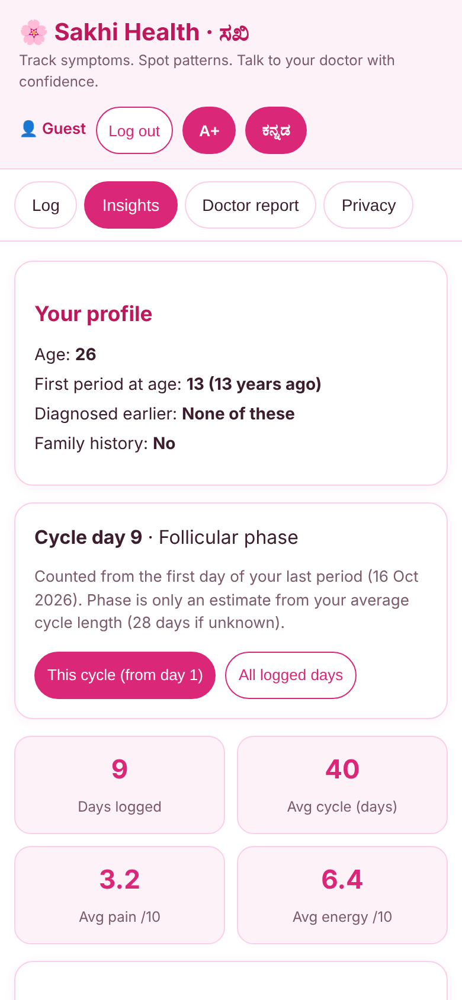
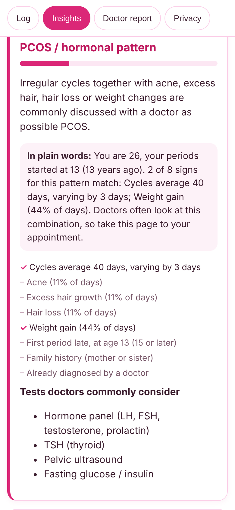
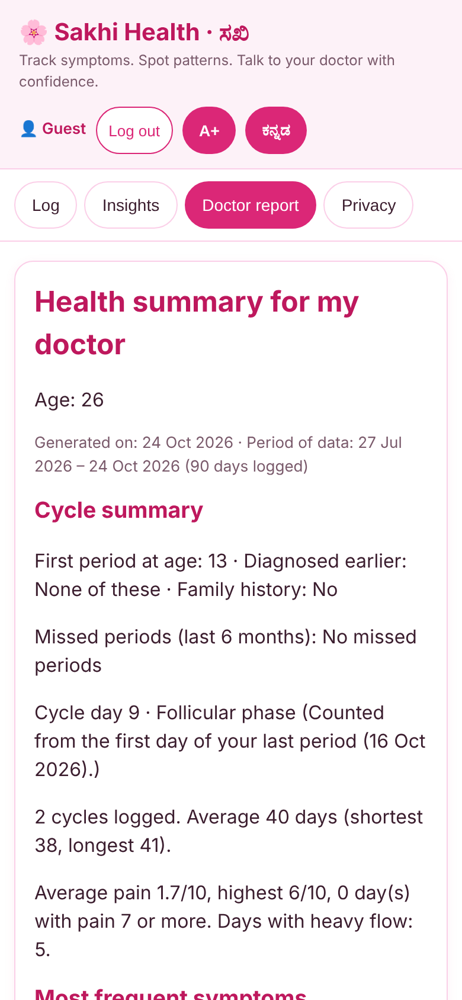
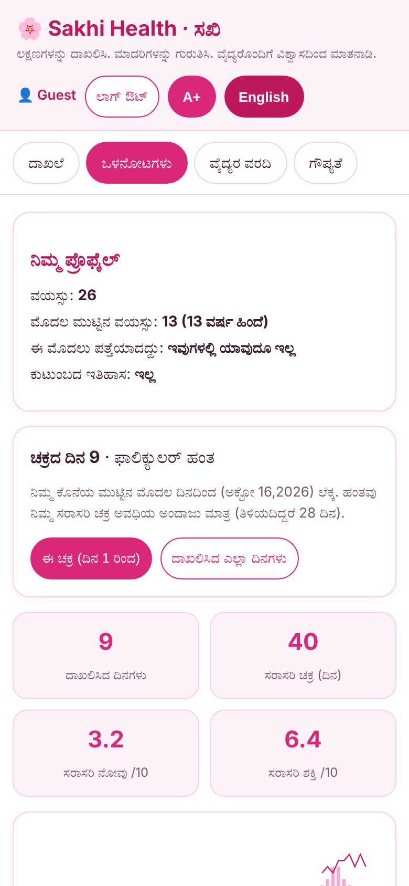
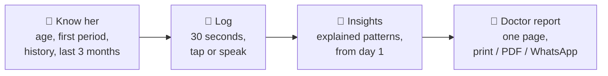
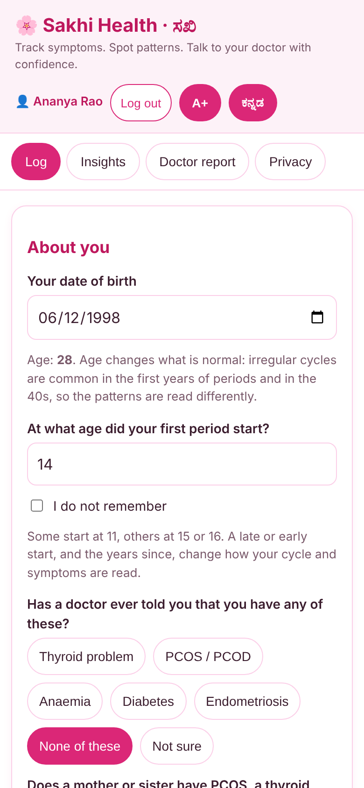
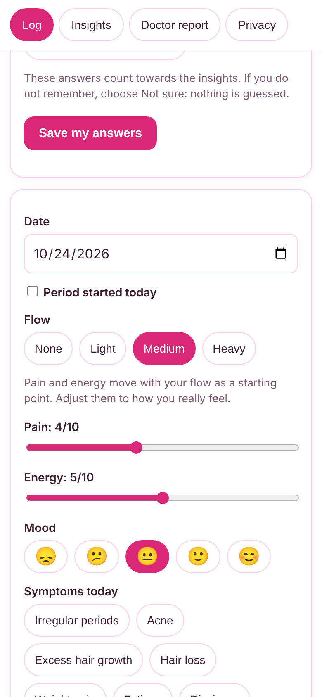
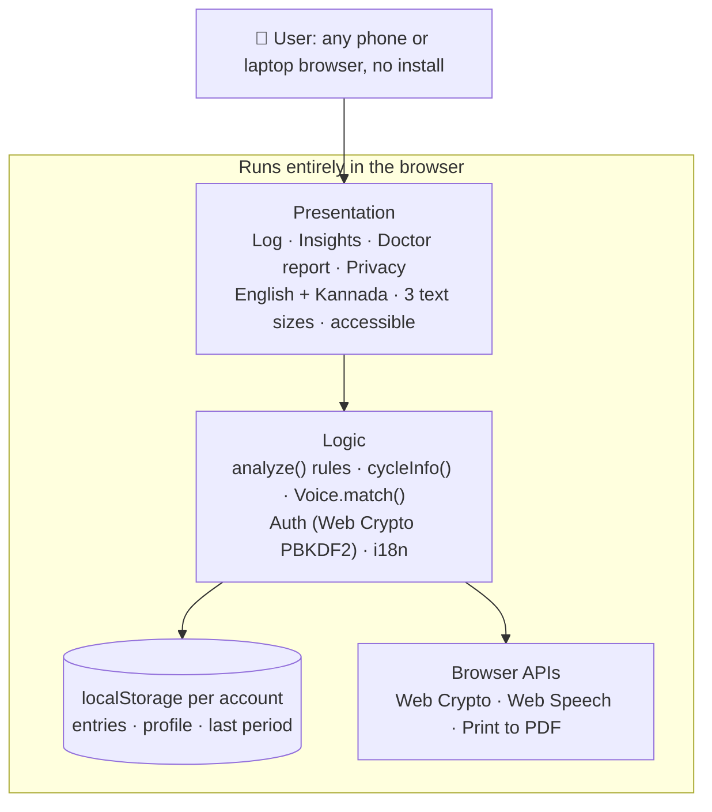

<div align="center">

# 🌸 Sakhi Health · ಸಖಿ

### *Her symptoms, understood. Her doctor, prepared.*

**A private, bilingual women's health companion that turns "something feels off" into a clear conversation with a doctor.**

[](../../actions/workflows/test.yml)


Built for **recHERsion'26** · ACM-W NITK Surathkal · Engineer NITK 2K26 · **Problem Statement 1: Women's Healthcare**

**[▶ Live demo](https://YOUR-USERNAME.github.io/sakhi-health/)** · **[📄 Sample doctor report](docs/sample-doctor-report.pdf)** · **[🎬 Demo video](#)** · **[📊 Pitch deck](#)**






</div>

---

## 💭 Why Sakhi exists

*Sakhi* (ಸಖಿ) means **a trusted friend**.

Meet **Meera**, a fictional example. She is 24. Her periods have been irregular since she was 15. She is often tired, her hair is thinning and she keeps getting acne. Each one seemed small, so she never mentioned them together. When she finally sees a doctor, the appointment is eight minutes long, and she can't remember what happened in which month.

Meera is not rare. The numbers say she is the rule:

| | |
|---|---|
| **10–13%** | of women of reproductive age have PCOS, and **up to 70%** of them are undiagnosed ([WHO](https://www.who.int/news-room/fact-sheets/detail/polycystic-ovary-syndrome)) |
| **4–12 years** | the average time to diagnose endometriosis, which affects about 1 in 10 women ([WHO](https://www.who.int/news-room/fact-sheets/detail/endometriosis)) |
| **57%** | of Indian women aged 15–49 are anaemic (NFHS-5, 2019–21, up from 53.1% in NFHS-4) ([PIB](https://www.pib.gov.in/PressReleasePage.aspx?PRID=1795421)) |

> Doctors look for patterns over **months**. Patients remember the last **few days**.
> Sakhi Health closes that gap.

---

## ✨ What Sakhi does



| Step | What happens |
|---|---|
| **1 · Know her** | Asks what a doctor would ask: date of birth, age at the first period, how periods have been since, past diagnoses, family history, last period, missed months and the last 3 months of symptoms. **"Not sure" is always a valid answer. Nothing is guessed.** |
| **2 · Log** | Under 30 seconds: period, flow, pain, energy, mood and 17 symptom chips. Tap them, or **speak them in English or Kannada**. Choosing a flow suggests pain and energy as a starting point. |
| **3 · Insights** | Four pattern checks (PCOS, anaemia, severe period pain, thyroid), plus early-cycle and perimenopause patterns. **Every card shows exactly which signs matched** and explains itself "in plain words". Available from day 1, without waiting weeks. |
| **4 · Doctor report** | Cycle facts, top symptoms, tests doctors commonly consider and questions to ask. Print it, save it as a PDF or share it on WhatsApp. |

### 🎯 What makes it different

| | Sakhi Health | Typical period tracker |
|---|---|---|
| **Reads age and cycle history** | A teen in her first 2 years of periods or a woman in her 40s is **not** told she "may have PCOS" from irregular cycles alone | One rule for everyone |
| **Day-1 insights** | From the intake answers, then daily logs gradually take over | Needs weeks of logging |
| **Explainable** | Open rules. Every matched sign is visible and checkable | Black box or no insight |
| **Her language** | Full Kannada interface and voice input | English only |
| **Private** | No server. Data stays on her device | Cloud accounts and tracking |
| **Built for the appointment** | One-page doctor report with questions to ask | Charts only |

---

## 🧠 The insight engine

Plain JavaScript. **No machine learning, on purpose:** there is no labelled medical dataset, and an opaque model guessing at health conditions would be unsafe. Rules can be read, tested and reviewed by a clinician. All of it lives in `analyze()` in [`js/app.js`](js/app.js).

### Patterns

| Pattern | Flagged when | Informed by |
|---|---|---|
| **PCOS / hormonal** | Irregular or long cycles, missed months or a long gap, plus at least one of acne, excess hair, hair loss, weight gain | Rotterdam criteria; 2023 International Evidence-based PCOS Guideline |
| **Iron deficiency / anaemia** | Frequent fatigue plus heavy flow, dizziness, pale skin or low energy | NICE NG88 on heavy menstrual bleeding; CBC and ferritin are the usual tests |
| **Severe period / pelvic pain** | Pain 7/10 or more on 2+ days, plus supporting signs | ESHRE 2022 endometriosis guideline |
| **Thyroid** | 4+ of 7 related symptoms occur often | Non-specific symptoms; TSH is the usual first test |
| **Early-cycle years** | Within 2 years of the first period: very long or short cycles, 3+ missed months, severe pain or heavy bleeding | ACOG Committee Opinion 651 |
| **Perimenopause** | 40+: changing cycles or 12 months without a period, plus hot flushes, poor sleep or mood change | STRAW+10 |

### It reads **who** you are, not just **what** you logged

| Context | What changes |
|---|---|
| **First 2 years after the first period** | Irregular cycles are **not** read as PCOS (they are common then) |
| **45 and over** | Irregular cycles are **not** read as PCOS (they are part of the menopause transition) |
| **Late first period (15+)** | Added as a supporting sign for PCOS and thyroid |
| **Early first period (before 12)** | Added as a supporting sign for endometriosis |
| **Already diagnosed by a doctor** | Shown as a sign. The card then says to use it to track symptoms and discuss follow-up |
| **Family history** | Added as a supporting sign for PCOS and thyroid |

### Your cycle story

One question, *"Since your first period, how have your periods been?"*, opens the insights with a plain-language story:

- **Regular since the first period** → PCOS-type problems are less likely; other signs count for less.
- **Regular at first, irregular later** → a change after regular years is worth a check (thyroid, PCOS, weight or stress, pregnancy).
- **Irregular since the start** → a common reason doctors check PCOS or thyroid, especially with acne, excess hair, hair loss or weight change.

### Day 1, then daily

Answers about the last 3 months (usual cycle length, regularity, flow, pain and how often each symptom happened) feed the **same rules**. As daily logs build up over about 14 days they gradually take over. Cards say where a sign came from, for example *"Acne (often, last 3 months)"* versus *"Acne (40% of days)"*. Insights are counted **from day 1 of the current cycle**, with a toggle for all logged days.

---

## 🖼️ Screens

<div align="center">

| Ask the basics | Flow guides pain & energy | Insights from cycle day 1 |
|:---:|:---:|:---:|
|  |  |  |

| Every sign is shown | Doctor-ready report | Full Kannada |
|:---:|:---:|:---:|
|  |  |  |

</div>

---

## 🚀 Try it in 60 seconds

1. Open the **[live demo](https://YOUR-USERNAME.github.io/sakhi-health/)** in Chrome.
2. Tap **Continue as guest (demo)**.
3. On the **Log** tab, tap **Load sample data (demo)**. This adds 90 made-up days and opens the insights.
4. Read a pattern card and its **"In plain words"** summary, then open the **Doctor report**.
5. Tap **ಕನ್ನಡ** to see everything in Kannada. Back on **Log**, tap **🎤 Speak your symptoms** and say *"I feel tired and dizzy, with period pain"*.

Prefer your own data? **Create account**, answer the "About you" questions and you get insights straight away, with nothing logged.

---

## 🔒 Privacy and responsibility

- **No backend, no tracking.** Everything is stored in the browser (`localStorage`) on the user's own device.
- **Passwords** are stored only as a salted **PBKDF2-SHA256** hash (150,000 iterations). 5 wrong attempts lock the email for 30 seconds.
- **One tap deletes** an account and its data.
- **Voice is optional.** In Chrome and Edge the browser sends speech to its own speech service to turn it into text. Nothing else leaves the device.
- **Never diagnoses.** It highlights patterns worth discussing with a doctor and shows an urgent-care warning for red-flag symptoms.
- **Honest limits.** The thresholds are heuristics from published guidelines. They are **not clinically validated** and should be reviewed by clinicians before real-world use.

> **Accounts are device-local.** They keep people's data separate on a shared phone or laptop. They are *not* server-side authentication: there is no password reset and no sync across devices. For production, replace `js/auth.js` with Firebase Auth or Supabase and keep the same functions (`register`, `login`, `guest`, `current`, `logout`, `remove`, `dataKey`). Secure sign-in uses the Web Crypto API, which needs https or localhost. GitHub Pages is https, and guest mode works anywhere.

---

## 🏗️ Architecture



| Module | Role |
|---|---|
| [`js/data.js`](js/data.js) | Symptoms, English/Kannada strings, pattern definitions |
| [`js/auth.js`](js/auth.js) | Register, login, guest, logout, delete account |
| [`js/voice.js`](js/voice.js) | Speech to symptoms (English + Kannada) with negation handling |
| [`js/app.js`](js/app.js) | State, analysis rules, cycle logic, all screens |

---

## ✅ Quality

- **84 automated tests** (`npm test`, no dependencies, runs in CI): pattern rules, age and cycle logic, voice matching, English/Kannada completeness, registration, login, lockout, data separation, sample data and rendering of every screen.
- **Accessibility:** an automated axe-core audit (WCAG 2.0/2.1 A and AA plus best practices) reports **0 violations** across the screens in English and Kannada. Labelled fields, focus styles, skip link, `aria-pressed` toggles, screen-reader names for the chart, three text sizes and reduced-motion support.

---

## 🛠️ Run it

No build step.

```bash
npm start            # serves on http://localhost:8000
npm test             # runs the 84 tests (Node 20+)
```

### On Streamlit

```bash
pip install -r requirements.txt
streamlit run streamlit_app.py
```

`streamlit_app.py` serves the same app inside Streamlit, so it **still runs entirely in the visitor's browser** and health data never reaches the Streamlit server. Deploy free on Streamlit Community Cloud with `streamlit_app.py` as the main file. Known limit: the embedded frame may block the microphone, so voice can be unavailable there; the GitHub Pages version supports it.

### On GitHub Pages

**Settings → Pages → Build and deployment → Deploy from a branch → `main` / `(root)` → Save.**
Live at `https://YOUR-USERNAME.github.io/sakhi-health/`

### Project structure

```
sakhi-health/
├── index.html            # page shell
├── css/style.css         # white and pink theme, print styles
├── js/                   # data.js · auth.js · voice.js · app.js
├── tests/run-tests.js    # test suite
├── streamlit_app.py      # optional Streamlit wrapper
├── docs/                 # screenshots and a sample doctor report PDF
├── .github/workflows/    # CI
└── package.json · requirements.txt · LICENSE · README.md
```

---

## 🗺️ Roadmap

- [x] Cycle- and age-aware insights, day-1 intake, voice, Kannada, doctor report
- [ ] Lab report upload with a plain-language explanation
- [ ] ASHA / health-worker mode for community screening
- [ ] Nearby specialist finder
- [ ] Clinician-reviewed and validated rules, more conditions
- [ ] Installable offline app, server-side accounts with encrypted sync

---

## 👩‍💻 Team

| | |
|---|---|
| **Chaitanya Pawar** | Team Leader |
| *Add teammate* | *role* |
| *Add teammate* | *role* |

---

## 📚 References and acknowledgements

**Statistics and guidelines**
1. WHO. [Polycystic ovary syndrome](https://www.who.int/news-room/fact-sheets/detail/polycystic-ovary-syndrome) (fact sheet)
2. WHO. [Endometriosis](https://www.who.int/news-room/fact-sheets/detail/endometriosis) (fact sheet)
3. NFHS-5 (2019–21) via the [Press Information Bureau, Govt. of India](https://www.pib.gov.in/PressReleasePage.aspx?PRID=1795421)
4. Teede HJ et al. International evidence-based guideline for the assessment and management of PCOS, 2023
5. Rotterdam ESHRE/ASRM-sponsored PCOS Consensus Workshop Group. *Fertil Steril*, 2004
6. NICE NG88. Heavy menstrual bleeding: assessment and management, 2018
7. ESHRE guideline: Endometriosis, 2022
8. ACOG Committee Opinion 651. Menstruation in girls and adolescents, 2015
9. Harlow SD et al. STRAW+10: staging reproductive aging, 2012

**Originality and tools**
- Built during the recHERsion'26 hackathon window.
- **AI assistance:** Anthropic's Claude was used for code generation, review and drafting. The team chose the problem, scope and design, and reviewed and tested the result.
- **Third-party code at runtime: none.** No libraries or APIs. It uses standard browser features (Web Crypto, Web Speech, localStorage). The optional Streamlit wrapper needs `streamlit`.
- **QA tooling (not in the app):** [axe-core](https://github.com/dequelabs/axe-core) and [Playwright](https://playwright.dev) for the accessibility audit and screenshots.
- Sample data and the persona "Meera" are made up. They are not real people.

---

<div align="center">

**⚠️ Disclaimer:** Sakhi Health is not a medical device and does not provide medical advice or diagnosis. Always consult a qualified doctor.

MIT © 2026 Chaitanya Pawar · Made with 💗 for recHERsion'26

</div>
